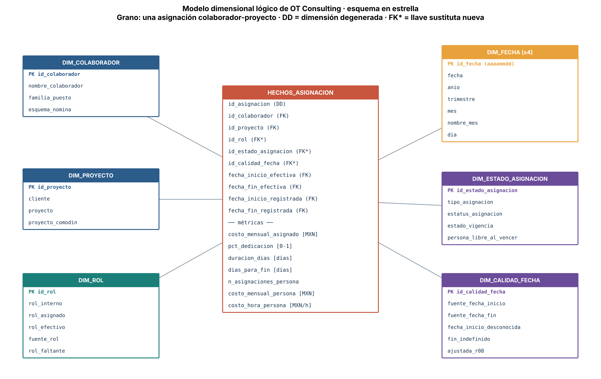
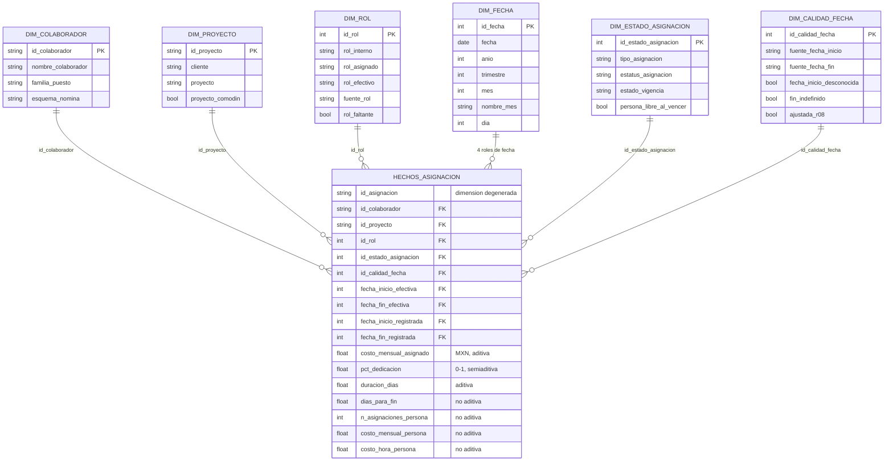

# Etapa 4 – Diseño del modelo dimensional lógico (OT Consulting)

**Alumno:** Alexis Arrazola Jiménez – A01664015

## Pasos de Kimball

| Paso | Decisión |
|---|---|
| 1. Proceso de negocio | Asignación de colaboradores a proyectos de clientes |
| 2. Granularidad | Una fila por asignación de un colaborador a un proyecto (`id_asignacion`) |
| 3. Dimensiones | Colaborador, Proyecto (Cliente > Proyecto), Rol, Fecha (4 roles), Estado de la asignación y Calidad de la fecha |
| 4. Hechos | `costo_mensual_asignado`, `pct_dedicacion`, `duracion_dias`, `dias_para_fin`, `n_asignaciones_persona`, `costo_mensual_persona`, `costo_hora_persona` |

La tabla de origen es `asignaciones_acondicionada` de la Etapa 3 (31 filas y 34 columnas). Cada uno de sus 34 atributos queda en un solo lugar del modelo.

## Diagrama

## Decisiones de diseño
- **Estrella, no copo de nieve:** Cliente y Proyecto quedan juntos en una dimensión para que las consultas usen menos uniones.
- **Dimensión degenerada:** `id_asignacion` se queda en la tabla de hechos.
- **Fecha con rol múltiple (*role-playing*):** `DIM_FECHA` se usa para inicio y fin, tanto efectivos como registrados. Tiene un miembro "desconocido" (`id_fecha = 0`) para las fechas que no existen en el origen.
- **Dimensiones de banderas (*junk*):** `DIM_ESTADO_ASIGNACION` y `DIM_CALIDAD_FECHA` agrupan banderas de baja cardinalidad, cada una con su llave sustituta.

La construcción y la prueba del modelo en pandas están en la sección 7 de [`Presentacion_Reto_OTC_Etapas_1a4.ipynb`](Presentacion_Reto_OTC_Etapas_1a4.ipynb). Ahí se verifica que hay 0 llaves huérfanas y que la métrica aditiva cuadra con la Etapa 3.
