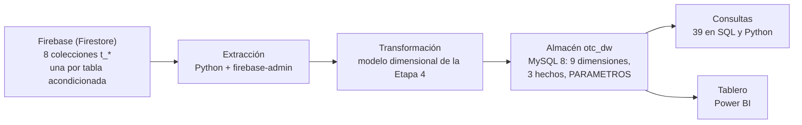

# Etapa 5 · Dimensiones, preparación de los datos y solución
**Entregable para el socio formador: OT Consulting**

**Alumno:** Alexis Arrazola Jiménez · A01664015 · Grupo 301 · Soporte analítico para la toma de decisiones
**Corte de los datos:** 17 de noviembre de 2026

El almacén de OT Consulting tiene **9 tablas de dimensión** alrededor de **3 tablas de hechos**:
- `HECHOS_ASIGNACION`, con 31 asignaciones,
- `HECHOS_EQUIPO`, con 123 equipos,
- `HECHOS_HABILIDAD`, con 1,529 evaluaciones.

Las **39 consultas** de este repositorio responden las preguntas P1 a P11. La solución es un tablero de Power BI más un conjunto de consultas en SQL y Python, y se instala en la arquitectura del cliente con los pasos de la sección 3.

| Archivo | Para qué sirve |
|---|---|
| `00_cargar_datos.sql` | Crea la base `otc_dw` en MySQL 8 con sus 13 tablas y los datos |
| `10_…` a `90_…sql` | Las consultas, un archivo por dimensión |
| `Etapa5_Consultas_por_dimension.ipynb` | Ejecuta las mismas consultas en Python y calcula los valores distintos de esta sección 1 |
| `Tablero_etapa_5.pbix` | Tablero dinámico de Power BI |

---

## 1. Valores distintos de cada dimensión

Criterio: si un atributo tiene **10 valores o menos, se listan**; si tiene **más de 10, se describen**. En la dimensión de fecha se da el rango.

| Dimensión | Miembros | Atributos | Origen |
|---|---|---|---|
| DIM_COLABORADOR | 107 personas (75 activas) | 67 | Etapa 4, ampliada |
| DIM_PROYECTO | 12 proyectos de 8 clientes | 14 | Etapa 4 |
| DIM_ROL | 12 combinaciones de rol | 6 | Etapa 4 |
| DIM_FECHA | 3,288 días + 1 miembro DESCONOCIDA | 7 | Etapa 4 |
| DIM_ESTADO_ASIGNACION | 5 combinaciones de estado | 5 | Etapa 4 |
| DIM_CALIDAD_FECHA | 5 combinaciones de banderas | 6 | Etapa 4 |
| DIM_EQUIPO | 123 equipos | 17 | Complementaria (P11) |
| DIM_HABILIDAD | 71 habilidades | 4 | Complementaria (P7, P8) |
| DIM_DEPARTAMENTO | 6 departamentos | 4 | Complementaria |

### 1.1 DIM_FECHA (cuándo)
- **Rango del calendario:** del **2019-11-01** al **2028-10-31**, con **3,288 días** distintos, uno por fila.
- También tiene el miembro **DESCONOCIDA** (`id_fecha = 0`). A él apuntan las fechas que el origen no trae: 21 inicios y 24 fines de asignación.
- **Atributos:** `anio` tiene 10 valores (2019 a 2028) y `trimestre` 4 (1 a 4). `mes` y `nombre_mes` tienen 12 valores (enero a diciembre) y `dia` tiene 31 (1 a 31).

Rango que usa cada rol de fecha en las tablas de hechos:

| Rol de la fecha | Más antigua | Más reciente | Filas con dato |
|---|---|---|---|
| Inicio efectivo de la asignación | 2025-11-03 | 2026-10-13 | 10 de 31 |
| Fin efectivo de la asignación | 2026-09-23 | 2028-10-30 | 8 de 31 |
| Inicio registrado de la asignación | 2025-11-03 | 2026-10-13 | 10 de 31 |
| Fin registrado de la asignación | 2027-01-01 | 2028-07-01 | 7 de 31 |
| Inicio de asignación de equipo | 2019-11-14 | 2026-10-23 | 55 de 123 |
| Fin de asignación de equipo | 2024-01-22 | 2026-11-04 | 10 de 123 |

La fecha *efectiva* es la ya corregida con las fechas oficiales del proyecto (regla R08). La *registrada* es la que venía en la asignación.

### 1.2 DIM_COLABORADOR (quién) · 107 personas
**Atributos con 10 valores o menos:**

| Atributo | Valores | Valores distintos |
|---|---|---|
| estatus_corte | 3 | ACTIVO; ACTIVO (BAJA PROGRAMADA); BAJA |
| pais | 2 | MÉXICO; COLOMBIA (1 sin dato) |
| nivel_puesto | 4 | Analista; Gerente; Practicante; Senior (46 sin puesto) |
| familia_puesto | 6 | ADMINISTRATIVO; COMERCIAL; CONSULTORÍA; GESTIÓN DE PROYECTOS; OTRO; SIN CLASIFICAR |
| departamento | 4 | ADMINISTRACIÓN Y FINANZAS; OPERACIONES Y SOPORTE; RECURSOS HUMANOS; VENTAS (48 sin dato) |
| esquema_nomina | 8 | ADMINISTRATIVA; EXTRANJERO; IRAZU/ASIMILADOS; OTC 100%; SIN DATO; SINDICATO MAGNESON; SINDICATO XERES; SMR |
| tipo_banca | 4 | BANCA CONSULTORÍA; BANCA NO CONSULTIVA; BANCA SIN CLASIFICAR (SIN PUESTO); NO APLICA (ASIGNADO O BAJA) |
| contrato_estatus | 3 | PENDIENTE; PLANTA; POR PROYECTO |
| sgmm_estatus | 3 | CON COBERTURA; PENDIENTE; SIN COBERTURA |
| anio_mes_baja | 3 | 2026-08; 2026-10; 2026-11 |
| docs_basicos_ok | 8 | 0 a 7 documentos completos |

Además hay **14 banderas 0/1**, como `es_activo`, `en_banca`, `expediente_completo` y `matriz_confiable`. También hay **9 campos de expediente** con dos valores, SI y PENDIENTE: acta, INE, CURP, constancia fiscal, NSS, comprobante de domicilio, banco, foto y formato de RH.

**Atributos con más de 10 valores, descritos:**

| Atributo | Valores | Descripción |
|---|---|---|
| id_colaborador / nombre_colaborador | 107 | Uno por persona (OTC003 a OTC110). Los nombres no se listan. |
| ubicacion | 23 | Ciudades de trabajo. Las más frecuentes son Monterrey (51), Estado de México (12) y Ciudad de México (12). |
| estado | 17 | Entidad federativa: Nuevo León (51), Estado de México (13) y Ciudad de México (12). 2 sin dato. |
| puesto | 23 | El más frecuente es Consultor Funcional Oracle EBS Senior (12), seguido de Consultor Técnico Java Senior (5). 46 personas sin puesto. |
| fecha_incorporacion | 85 | Del 2003-04-01 al 2026-10-06. 1 sin fecha. |
| antiguedad_anios | 56 | De 0.1 a 23.6 años, con promedio de 5.0. |
| sueldo_total_integrado | 75 | De $0 a $135,461 al mes. Es el costo mensual de cada persona (R03). |
| costo_hora | 66 | De $46.6 a $846.6 por hora, con promedio de $349.9. Se calcula para las 70 personas activas con sueldo (R10). |
| n_habs_evaluadas | 33 | De 0 a 69 habilidades evaluadas por persona. |

### 1.3 DIM_PROYECTO (para quién y en qué) · 12 proyectos
| Atributo | Valores | Valores distintos o descripción |
|---|---|---|
| cliente | 8 | ALLEGION; CITI; FANOSA; GRUPO DALTILE; METALSA; NOVOCAST; PARKER SERVICIOS DE MÉXICO; RENT A CENTER (RAC MÉXICO OPERACIONES) |
| industria | 4 | AUTOMOTRIZ; CONSULTORÍA; MANUFACTURA; RENTAS DE EQUIPO |
| estatus_proyecto | 2 | EN CURSO (7); POR INICIAR (5) |
| fecha_inicio | 6 | 2021-01-01; 2023-01-01; 2025-06-01; 2026-06-30; 2026-07-15; 2026-10-13 (6 sin fecha) |
| fecha_fin | 3 | 2026-09-23; 2026-10-30; 2028-10-30 (9 sin fecha) |
| pm_otc | 2 | 2 personas (no se listan); 6 proyectos sin PM |
| proyecto | 12 | Uno por proyecto, por ejemplo AMS Manufactura, Marazzi o Migración EBS. "Asignación indefinida" es un proyecto comodín, no un proyecto real. |

### 1.4 DIM_ROL (con qué función) · 12 combinaciones
| Atributo | Valores | Valores distintos o descripción |
|---|---|---|
| rol_asignado | 2 | CONSULTOR FUNCIONAL ORACLE EBS SENIOR; NO APLICA |
| fuente_rol | 3 | ROL ASIGNADO; ROL INTERNO; SIN ROL |
| rol_faltante | 2 | SI; NO |
| rol_interno | 11 | Roles de consultoría (Oracle EBS y Cloud, Java, web, Kronos y DBA) y un gerente de proyectos. NO APLICA es el único que se repite. |
| rol_efectivo | 11 | El rol con el que se costea la asignación. Consultor Funcional Oracle EBS Senior aparece en 2 combinaciones. |

### 1.5 DIM_ESTADO_ASIGNACION (en qué situación está) · 5 combinaciones
| Atributo | Valores | Valores distintos |
|---|---|---|
| tipo_asignacion | 2 | ASIGNACIÓN; PROYECTO |
| estatus_asignacion | 1 | EN CURSO |
| estado_vigencia | 3 | INDEFINIDA / SIN FECHA FIN; MÁS DE 90 DÍAS; VENCIDA |
| persona_libre_al_vencer | 3 | SI; NO; NO APLICA |

### 1.6 DIM_CALIDAD_FECHA (qué tan confiable es la fecha) · 5 combinaciones
| Atributo | Valores | Valores distintos |
|---|---|---|
| fuente_fecha_inicio | 3 | ASIGNACIÓN; DESCONOCIDA; PROYECTO (ajustada R08) |
| fuente_fecha_fin | 4 | ASIGNACIÓN; INDEFINIDA O DESCONOCIDA; PROYECTO (ajustada R08); PROYECTO (completa nulo) |
| fecha_inicio_desconocida | 2 | SI; NO (21 asignaciones con SI) |
| fin_indefinido | 2 | SI; NO (24 con SI) |
| ajustada_r08 | 2 | SI; NO (3 con SI, todas de Marazzi) |

### 1.7 DIM_EQUIPO (complementaria) · 123 equipos
| Atributo | Valores | Valores distintos o descripción |
|---|---|---|
| tipo | 2 | LAPTOP; MONITOR |
| marca | 5 | ACER; ASUS; DELL; HP; LENOVO |
| situacion_equipo | 4 | EN USO (72); DISPONIBLE (32); DEVUELTO / CERRADO (10); POR RECUPERAR (9) |
| estatus_responsable | 3 | ACTIVO; BAJA; SIN RESPONSABLE |
| cod_activo | 123 | Uno por equipo, de A0001 a A0128 |
| modelo | 73 | El más frecuente es Inspiron Business 3520 (20 equipos), seguido de V14 G2 ITL (7). 1 sin modelo. |
| serie | 122 | Número de serie de cada equipo (no se listan) |

Además tiene 9 banderas 0/1: costo desconocido, sin responsable, a nombre de baja, por recuperar y fecha anómala, entre otras.

### 1.8 DIM_HABILIDAD (complementaria) · 71 habilidades
| Atributo | Valores | Valores distintos o descripción |
|---|---|---|
| tecnologia | 6 | CERTIFICACIONES; IDIOMAS; ORACLE EBS; ORACLE FUSION CLOUD; OTROS; PLATAFORMAS TECNOLÓGICAS |
| tipo_habilidad | 2 | HARD; SOFT |
| habilidad | 71 | Una por habilidad, por ejemplo Oracle EBS GL, OPM o TALEO, y plataformas como OCI u OBI. Se evaluaron 1,529 combinaciones de persona y habilidad. |

### 1.9 DIM_DEPARTAMENTO (complementaria) · 6 departamentos
| Atributo | Valores | Valores distintos o descripción |
|---|---|---|
| departamento | 6 | ADMINISTRACIÓN Y FINANZAS; DIRECCIÓN GENERAL; OPERACIONES Y SOPORTE; PROCESOS Y MEJORA CONTINUA; RECURSOS HUMANOS; VENTAS |
| estatus | 1 | ACTIVO |
| objetivo | 6 | Un texto por departamento que describe su función |

---

## 2. Preparación de los datos (origen en Firebase)

El flujo va de las colecciones de Firebase al almacén dimensional:



1. **Origen.** Cada tabla acondicionada de la Etapa 3 vive en Firestore como una colección (`t_colaboradores`, `t_asignaciones`, `t_proyectos`, `t_activos`, `t_habilidades_largo`, `t_habilidades_cobertura`, `t_roles` y `t_departamentos`). Cada documento es una fila y su id es la llave natural, por ejemplo `OTC003` o `A0001`.
2. **Extracción.** Python lee cada colección y la convierte en una tabla:
   ```python
   import firebase_admin, pandas as pd
   from firebase_admin import credentials, firestore
   firebase_admin.initialize_app(credentials.Certificate('cuenta_servicio.json'))
   db = firestore.client()
   tablas = {c.id: pd.DataFrame([d.to_dict() | {'_id': d.id} for d in c.stream()]) for c in db.collections()}
   ```
3. **Transformación** al modelo de la Etapa 4. Estas son las decisiones que se tomaron:
   - **Llaves sustitutas** para Rol, Estado y Calidad de fecha, una por cada combinación distinta de atributos.
   - **Miembro DESCONOCIDA** (`id_fecha = 0`) en lugar de llaves nulas: 21 asignaciones no tienen inicio y 24 no tienen fin.
   - **Regla R08:** si una asignación se sale de las fechas del proyecto, manda el proyecto. Se ajustaron 3 asignaciones y quedaron marcadas.
   - **Costo:** costo por hora = sueldo total integrado / 160 horas (R10). Con varias asignaciones, el costo se reparte en partes iguales (R06).
   - **Fechas imposibles:** una fecha anterior al año 2000 se trata como desconocida y se marca. Fue el caso del equipo A0075, que traía el año 199.
   - **Modelo ampliado:** se agregaron 3 dimensiones complementarias (equipo, habilidad y departamento) para responder P7 a P11.
4. **Carga.** El resultado se exporta como `00_cargar_datos.sql`, que crea el esquema (llaves primarias y foráneas) y carga los datos en MySQL. La tabla `PARAMETROS` guarda la fecha de corte (2026-11-17) y las horas por mes (160). Con eso, el siguiente corte solo cambia ese valor.
5. **Verificación.** Las consultas reproducen las cifras de la Etapa 3 en SQL y en Python. Ejemplos:
   - 40.0 % de utilización,
   - banca de $1,994,154 al mes (50.9 % de la nómina de $3,918,864),
   - 4 de 7 proyectos sin personal,
   - 9 equipos por recuperar.

---

## 3. Solución resultante y cómo instalarla en la arquitectura del cliente

### 3.1 Tablero dinámico (Power BI) · `Tablero_etapa_5.pbix`
- **Indicadores en tarjetas:** activos, asignaciones, utilización, personas en banca, costo y peso de la banca, proyectos sin cobertura, personas que se liberan en 90 días, equipos por recuperar, % de expedientes completos y habilidades con poca cobertura.
- **Filtro por cliente** que actualiza todo el tablero.
- **Gráficas:**
  - asignaciones por estado de vigencia (P2),
  - tabla de asignaciones por colaborador, proyecto y rol con su costo (P5),
  - árbol de descomposición del costo de la banca por esquema de nómina, familia de puesto y ubicación (P6),
  - dispersión de utilización contra costo de banca por familia de puesto,
  - gráfica de cascada,
  - rotación mensual (P9),
  - valor por recuperar por marca de equipo (P11).

### 3.2 Consultas para Dirección
- **SQL:** cada archivo `10_…` a `90_…sql` abre en MySQL Workbench y muestra una pestaña de resultados por pregunta.
- **Python:** `Etapa5_Consultas_por_dimension.ipynb` ejecuta las mismas consultas sin instalar un servidor (SQLite en memoria). Abre en Google Colab o en VS Code.

### 3.3 Pasos de instalación
**Requisitos:**
- MySQL 8 (también funciona con MariaDB 10.11)
- Power BI Desktop
- Python 3.10 o superior con pandas
- Si el origen es Firebase, una cuenta de servicio del proyecto

1. **Descargar el repositorio:** `git clone https://github.com/Arrazola77/OTC-EDA-Individual-Alexis`.
2. **Crear el almacén:** `mysql -u root -p < 00_cargar_datos.sql`. También se puede abrir y ejecutar en MySQL Workbench. Se crea la base `otc_dw`.
3. **Probar las consultas:** ejecutar `10_dim_colaborador.sql` a `90_dim_departamento.sql`. La utilización debe dar 40.0 % y la nómina activa $3,918,864.
4. **Conectar el tablero:** abrir `Tablero_etapa_5.pbix`. En *Transformar datos → Configuración de origen de datos*, apuntar al servidor MySQL del cliente (base `otc_dw`) y actualizar. Para compartirlo con Dirección, publicarlo en Power BI Service y programar la actualización con una puerta de enlace (gateway).
5. **Actualizar cada mes:** volver a extraer de Firebase y regenerar el almacén. Cambiar `fecha_corte` en `PARAMETROS` y actualizar el tablero.

---

## 4. Límites y decisiones pendientes para OT Consulting
- **P8 es una aproximación.** El catálogo de clientes no trae el perfil que pide cada proyecto, así que se usan como referencia las habilidades con poca cobertura de P7.
- **La banca incluye casos dudosos.** De las 45 personas en banca, 15 no tienen puesto registrado. Puede que falte capturar su asignación.
- **Sin rentabilidad.** No hay tarifas de venta y el costo se reparte en partes iguales entre las asignaciones de cada persona.
- **El valor de los equipos es un mínimo.** 70 de 123 equipos no tienen costo, así que el valor por recuperar ($40,693) es el piso.
- **Metas por validar.** Las metas son propuestas de la Etapa 2, como 85 % de utilización o 10 % de banca como máximo.
- **Firebase sin probar contra un proyecto real.** La lectura de Firestore no se ejecutó con un proyecto real de OTC. Conviene probarla primero con el emulador de Firestore.
